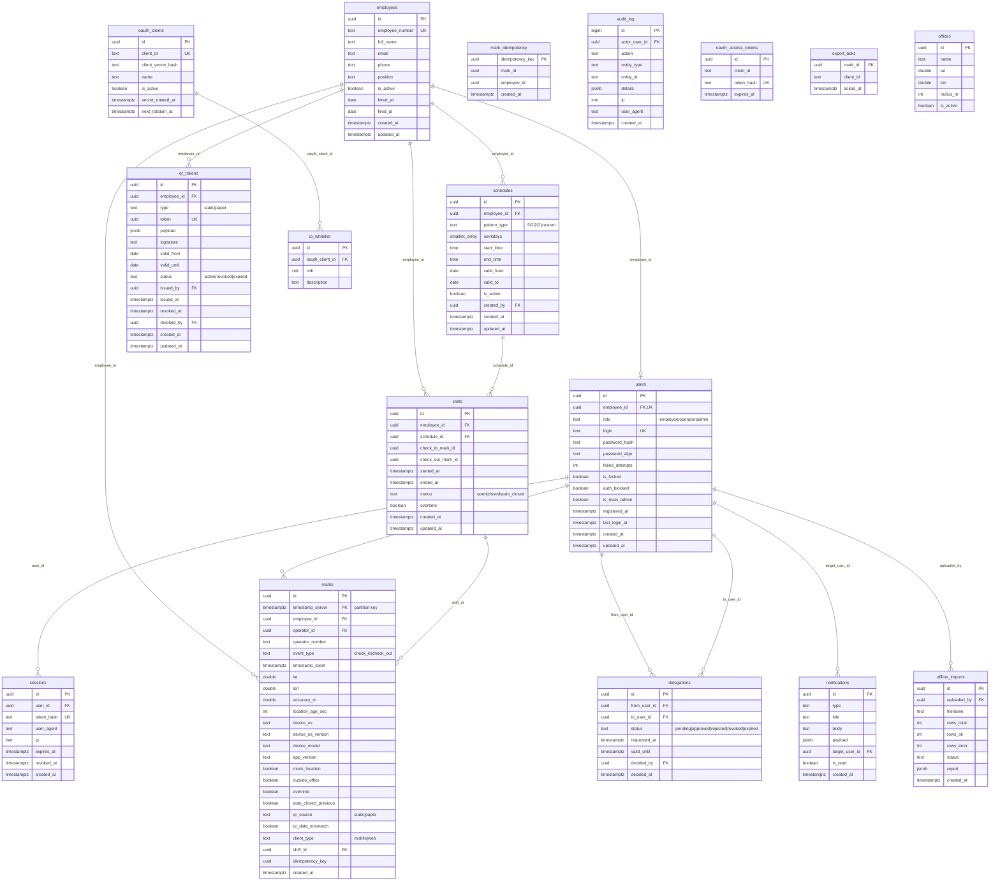

# ERD — схема базы данных «Табель»

Версия: 1.0 (Этап 1)
СУБД: PostgreSQL 16
Источник истины: SQL-миграции `backend/internal/db/migrations/*.sql` (goose).
Машиночитаемая схема для dbdiagram.io: [`schema.dbml`](./schema.dbml).

## Диаграмма

## Ключевые проектные решения

### Партиционирование `marks`

Таблица `marks` партиционирована по `RANGE (timestamp_server)` — по месяцам.
Первичный ключ составной: `(id, timestamp_server)` (требование PostgreSQL для
партиционированных таблиц). При создании миграция создаёт партиции на текущий и
6 следующих месяцев; функция `create_marks_partition(date)` создаёт партицию
идемпотентно и вызывается регламентно (автогенерация — Этап 12).

Индексы (наследуются партициями):
- `(employee_id, timestamp_server DESC)` — отметки сотрудника;
- `(operator_id, timestamp_server)` — отметки оператора;
- `(shift_id)`, `(idempotency_key)`.

### Идемпотентность отметок

`mark_idempotency` хранит соответствие `Idempotency-Key → mark_id` для защиты от
повторной вставки при ретраях. Дополнительно `marks.idempotency_key` фиксирует
ключ на самой отметке.

### График и смены

Один активный график на сотрудника обеспечивается частичным уникальным индексом
`uq_schedules_active_per_employee ... WHERE is_active`. Смена (`shifts`) ссылается
на график и на отметки входа/выхода; статус отражает обычное/автозакрытие.

### QR-токены

Тип `static` или `paper`. Частичные уникальные индексы гарантируют не более одного
активного токена каждого типа на сотрудника. Подпись ECDSA хранится в `signature`,
полезная нагрузка — в `payload` (JSONB).

### Делегирование и уведомления

`delegations` описывает передачу прав оператора с жизненным циклом
`pending → approved/rejected → revoked/expired`. `notifications` — внутренние
уведомления (автозакрытие, делегирование, истечение QR и т.д.).

### Экспорт и OAuth

`oauth_clients` + `oauth_access_tokens` + `ip_whitelist` — OAuth 2.0
client_credentials с ограничением по IP. `export_acks` фиксирует подтверждённую
внешней системой выгрузку (идемпотентно по `mark_id`). `offline_imports` хранит
отчёты о загрузке офлайн-данных.

### Аудит

`audit_log` — append-only журнал действий с актором, сущностью и деталями (JSONB).

### Геозона

`offices` — геозоны офисов (координаты и радиус, по умолчанию 500 м).

## Конфигурация подключения (SQLite на сервере приложений)

Настройки подключения к PostgreSQL/Redis и профиль главного администратора хранятся
в SQLite-хранилище на сервере приложений (`SETTINGS_DB_PATH`, по умолчанию
`/data/settings.db`). Секреты (пароль БД, пароль Redis) шифруются AES-GCM ключом
`SETTINGS_ENCRYPTION_KEY`. Первичная настройка выполняется через веб-интерфейс
(эндпоинты `/setup/*`).
